# Tags & Relationships

Tags are a generic labeling system that lets you categorize and filter entities across your projects. Each tag has a `name` and a `color`, and can be attached to any taggable entity.

## Taggable Entities

Tags can be applied to the following entities via dedicated pivot tables:

| Entity           | Pivot service             | Example use                                      |
| ---------------- | ------------------------- | ------------------------------------------------ |
| **Resource**     | `IResourceTagService`     | Group related resources (e.g. "billing", "auth") |
| **User**         | `IUserTagService`         | Label users by team or department                |
| **Role**         | `IRoleTagService`         | Categorize custom roles                          |
| **Group**        | `IGroupTagService`        | Organize permission groups                       |
| **Permission**   | `IPermissionTagService`   | Tag permissions by domain                        |
| **Organization** | `IOrganizationTagService` | Classify organizations                           |
| **Project**      | `IProjectTagService`      | Label projects by environment or purpose         |
| **Project App**  | `IProjectAppTagService`   | Label apps by purpose or environment             |
| **Account**      | `IAccountTagService`      | Tag accounts                                     |

Each pivot relationship supports an optional `isPrimary` flag to designate a primary tag per entity.

## Scope Behavior

Tags follow the same tenant scoping rules as all other entities:

- A tag created in an **Account** scope is only visible within that account
- A tag created in an **Organization** scope is only visible within that organization
- A tag created in a **Project** scope (either `AccountProject` or `OrganizationProject`) is only visible within that project

When a tag is deleted, it is automatically removed from all entity pivot tables within the scope in a single transaction.

## Intersection Filtering

All entity queries that support tags use **intersection filtering** — when you provide multiple `tagIds`, only entities that have **all** specified tags are returned.

```
GET /resources?tagIds=tag-1,tag-2,tag-3
```

This is equivalent to an AND filter: return resources tagged with `tag-1` AND `tag-2` AND `tag-3`. The intersection is computed at the pivot table level before the main entity query runs, keeping the operation efficient.

## CRUD Operations

Tags support standard CRUD via GraphQL mutations:

| Operation | Mutation     | Permission   |
| --------- | ------------ | ------------ |
| Create    | `createTag`  | `Tag:Create` |
| Update    | `updateTag`  | `Tag:Update` |
| Delete    | `deleteTag`  | `Tag:Delete` |
| List      | `tags` query | `Tag:Query`  |

Attaching and detaching tags from entities is handled through entity-specific mutations (e.g. adding a tag to a resource is part of the resource mutation flow, not the tag mutation flow).

## Relationship counts

Users, roles, groups and permissions report how many of each related entity they have in the requested scope:

| Field                   | Counts                                                               |
| ----------------------- | -------------------------------------------------------------------- |
| `Permission.groupCount` | Groups of the scope that hold the permission                         |
| `Permission.userCount`  | Users holding the permission directly, not through a group or a role |
| `Group.userCount`       | Users assigned to the group directly, not through a role             |
| `Group.roleCount`       | Roles of the scope that include the group                            |
| `Role.userCount`        | Users the role is assigned to directly                               |
| `User.groupCount`       | The user's direct groups in the scope, not those a role brings       |
| `User.permissionCount`  | The user's direct permissions in the scope                           |

**Rules**

- **Direct assignments only.** A user who gets a permission through a group or a role is not counted.
- **In a project,** the counts read the project's own assignments (`project_user_groups`, `project_user_permissions`) whose global assignment is live, as authorization does.
  Roles have no project assignment table: a role's users in a project are its `user_roles` rows of the project's users.
- **In an organization,** they read the organization's users.
- **Lists:** the user, role, group and permission lists count a whole page in one grouped query per count.
- **REST:** the counts are requested with `?fields=`: `userCount` and `roleCount` on groups, `groupCount` and `userCount` on permissions, `userCount` on roles, and `groupCount` on users.

**The related entities**

The lists behind the counts are `Permission.groups`, `Permission.users`, `Group.users`, `Group.roles`, `Role.users`, `User.groups` and `User.permissions`, each taking `page` and `limit` and sorted by name.

- **Authorization:** each is checked like the list it comes from: `users` needs `User:Query`, `groups` needs `Group:Query`, `roles` needs `Role:Query` and `permissions` needs `Permission:Query`. Without that permission the field is an authorization error, while the count still resolves.
- **In the web app:** the counts are chips that list the first ten on hover, focus or tap. A viewer who may not list users sees the count and _Not available_.

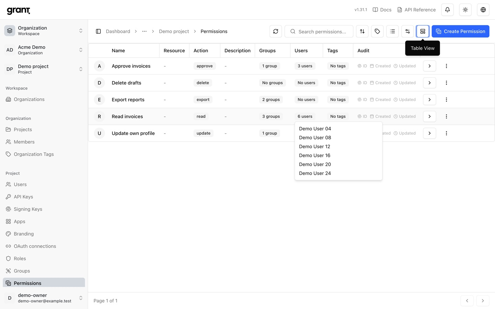

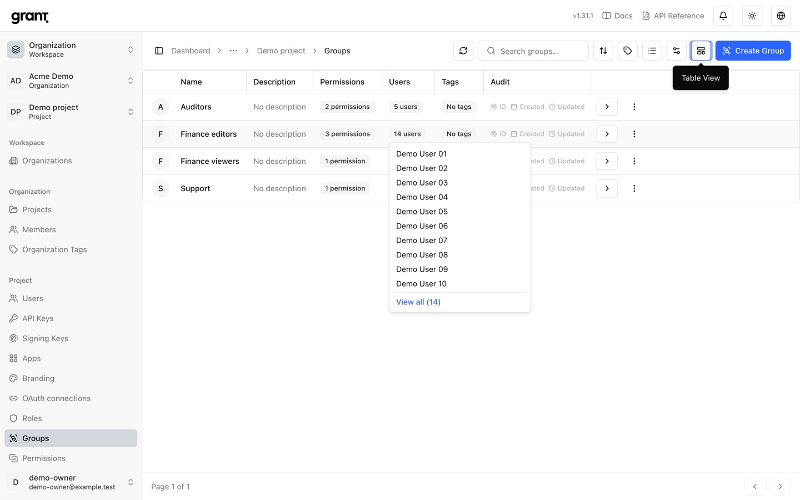

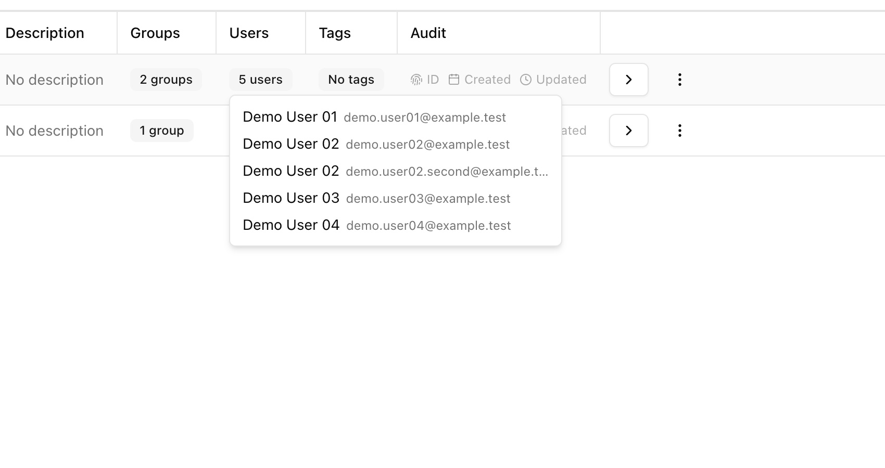

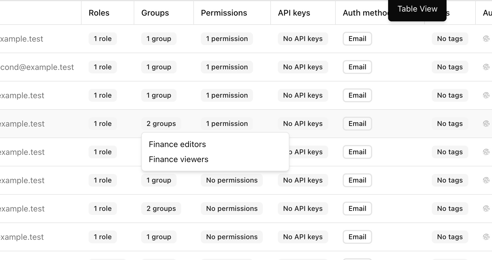

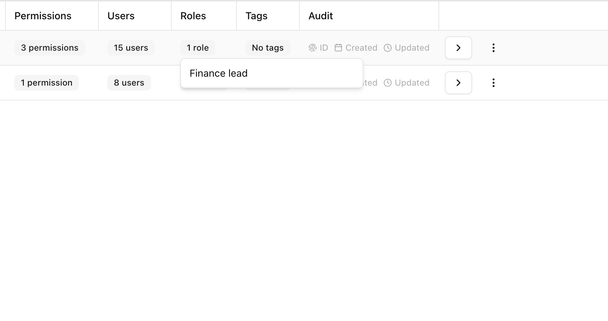

### On detail pages

The permission page lists the permission's **Groups** and **Users**, the group page lists its **Members** and the **Roles** that include it, and the role page lists its **Users**. Each card shows ten per page, and each row links to its own page. The cards are read-only: groups get permissions on the group's page, groups join a role on the role's page, and users get roles, groups and permissions on the user's page.

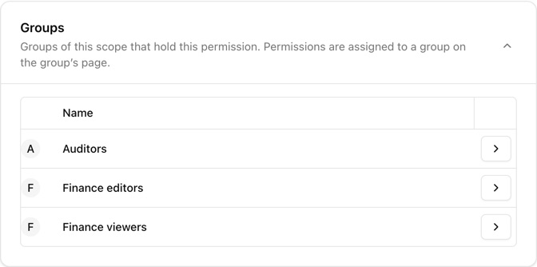

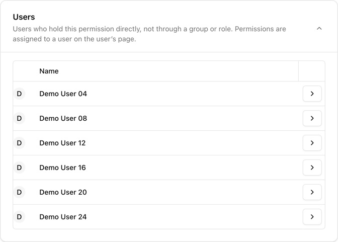

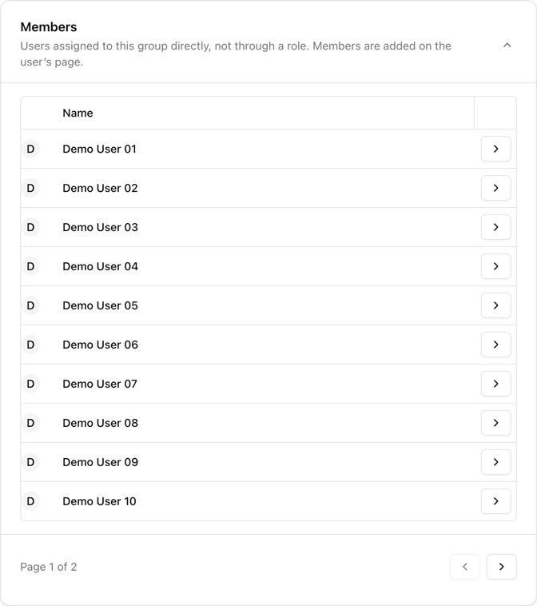

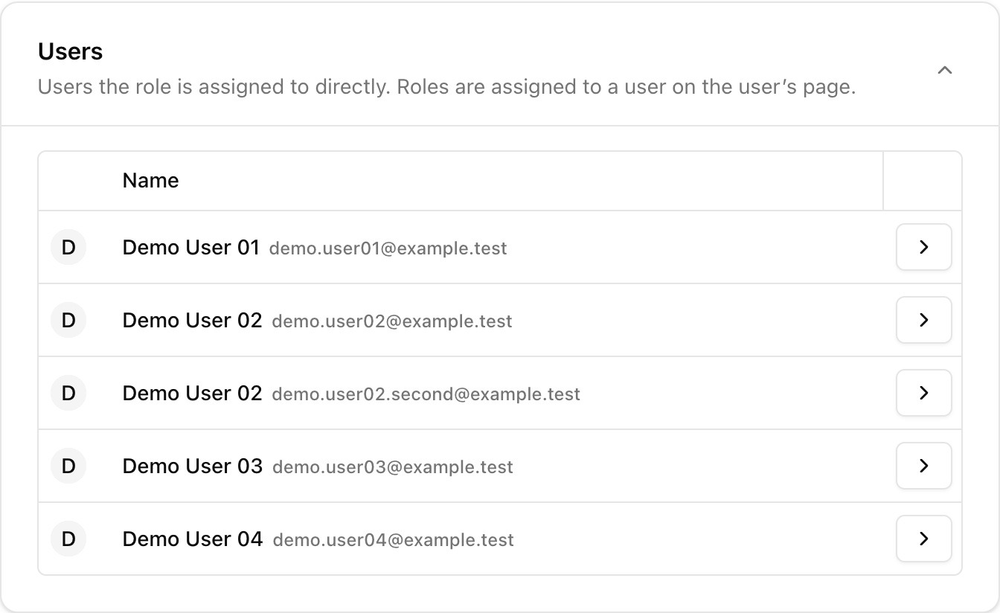

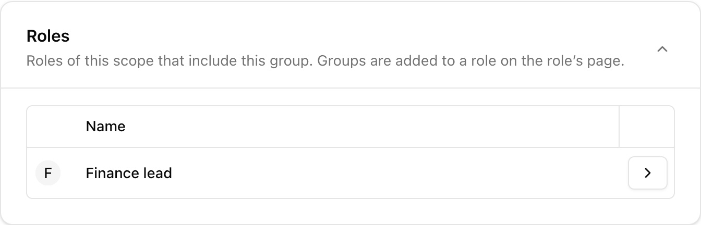

### Users in relationship lists

Names are not unique, so wherever a relationship lists users (a Users chip's preview, a Users or Members card) each user shows as their name with their email muted beside it. The email is the address of the user's Email sign-in method; a user without one shows the name alone. Emails come with the same field as the names, so a viewer who may not list users sees neither.

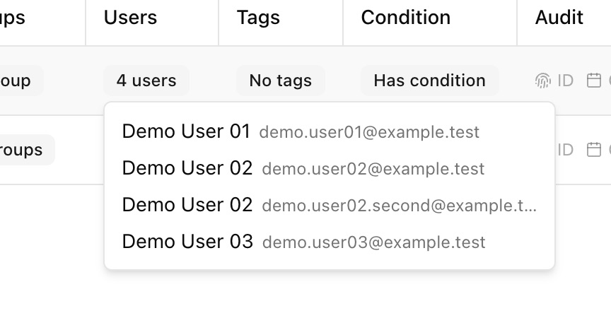

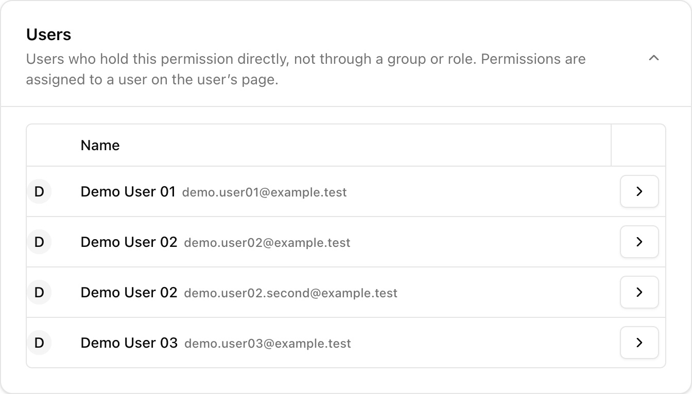

### Metadata on detail pages

User, role, group and permission pages each have a **Metadata** card. It starts collapsed. Its JSON editor grows with the metadata up to a fixed cap and then scrolls inside itself, so a long document does not push the rest of the page down. Viewers who may update the entity can edit and save it there; others see it read-only.

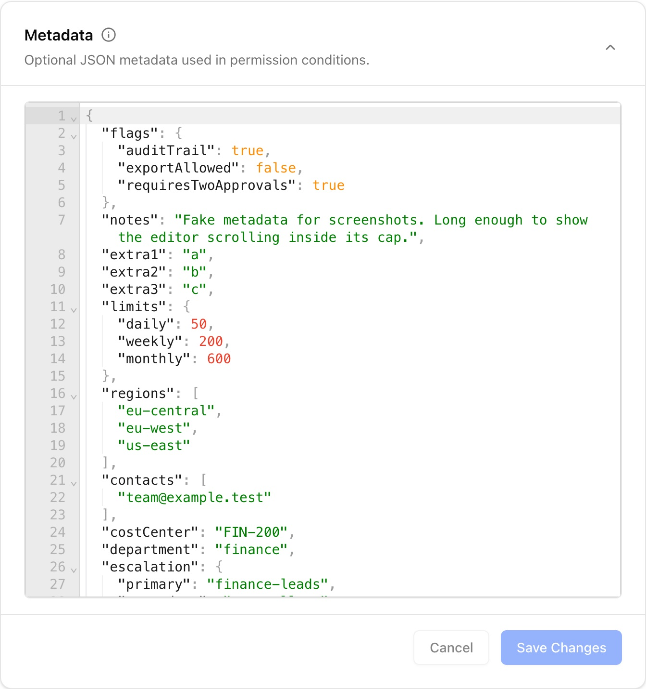

## Tag color palette

Tag colors are defined in `@grantjs/constants` and must be **perceptually distinct**. We use the **CIEDE2000 (ΔE00)** metric in LAB space, comparing each color at **Tailwind shade 500**. Every pair of palette colors must have ΔE00 ≥ `MIN_PALETTE_DELTA_E` (see `packages/@grantjs/constants/src/colors.ts`). This avoids ambiguous choices (e.g. multiple near-identical grays). The palette check is enforced in CI via `pnpm --filter @grantjs/constants run check:palette`. When adding or changing tag colors, ensure the script passes.

## CDM lifecycle for tags

Project permission CDM (canonical data model) sync supports tags as a first-class section. When a CDM artifact is imported into a project (`POST /api/projects/:id/sync/jobs`) or exported via an async export job (`POST /api/projects/:id/sync/jobs/export` with `sections` including `tags`), the platform round-trips:

- the `tags` section — project-visible tag definitions plus `project_tags` membership rows,
- `tagKeys` / `groupTagKeys` on each `roleTemplates[i]` — `role_tags` and `group_tags` associations for the role's auto-created CDM group,
- `tagKeys` on each `userAssignments[i]` — global `user_tags` rows for the assigned user.

### CDM identity envelope

Tag rows created by CDM sync carry a reserved `metadata.cdmImport` envelope. The exporter emits derived, opaque external keys (e.g. `cdm-tag-3f2a9b1c0d1e2f30`) and threads the original Grant id through `metadata.cdmSource` for traceability:

```json
{
  "cdmImport": {
    "projectId": "<importing project>",
    "kind": "tag",
    "externalKey": "cdm-tag-3f2a9b1c0d1e2f30"
  },
  "cdmSource": {
    "grantTagId": "<original Grant tag UUID>",
    "...": "importer-supplied JSON"
  }
}
```

`externalKey` is opaque: Grant only requires uniqueness within the document. Importer-supplied keys are accepted as-is, while Grant's exporter generates them via `buildExternalKey('tag', tagId, name, color)` so the same row maps to the same key on re-export. Only rows with the `cdmImport` envelope are torn down on re-import. User-created tags (via `createTag` or the UI) never carry `cdmImport` and are never touched by CDM sync, including its replace-import sweep. See [CDM import & export → identity contract](/core-concepts/cdm-import-export#identity-contract-opaque-external-keys) for the full contract shared by all CDM-portable entities.

### Project membership creation

The CDM `tags` section creates membership in the importing project via `project_tags`. A tag entry that you import into project `A` is not automatically visible in project `B`; the CDM artifact is the unit of project membership. Re-importing the same artifact into a second project would create a second CDM-marked tag row (parallel to how role templates work today).

### Cross-project effect of `user_tags`

`user_tags` rows are global — Grant attaches them to the user, not the project. Re-importing an artifact whose `userAssignments[i].tagKeys` references a tag created in this project will:

- create the global `user_tags` row, and
- make that tag visible on the user across **every** project the user belongs to.

This is the same behaviour as direct user mutations through the API; CDM sync does not gate it. The export dialog and OpenAPI description both warn about this trade-off, but the contract is explicit: opt in by including the `tags` and `userAssignments` sections together.

### Teardown semantics

`TagHandler.teardown` runs at order 5, before `RoleTemplateHandler` (10) and `UserAssignmentHandler` (20), and:

1. lists every tag whose `metadata.cdmImport.projectId` matches the importing project;
2. soft-deletes those tag rows **and** their pivot rows in `project_tags`, `role_tags`, `group_tags`, `user_tags`, `project_app_tags` (apps in this project only), `permission_tags`, and `resource_tags` in a single batch (soft-delete cascades do not fire on the FK side, so the pivots must be removed explicitly).

Plain user-created tags are never affected, even if they share a name or color with a CDM-imported tag.

---

**Related:**

- [Resources](/core-concepts/resources) — Taggable resource entities
- [Data Model](/architecture/data-model) — Entity relationships and pivot tables
- [RBAC System](/architecture/rbac) — Permission evaluation for tag operations
- [CDM import/export](/core-concepts/cdm-import-export) — Full CDM import/export contract
