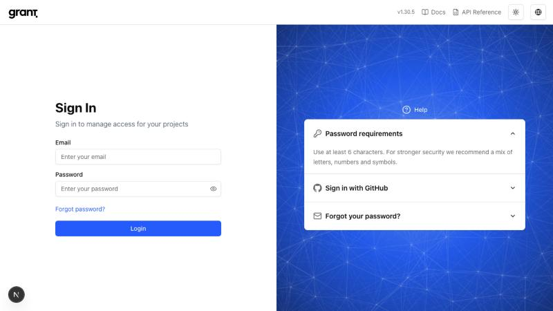
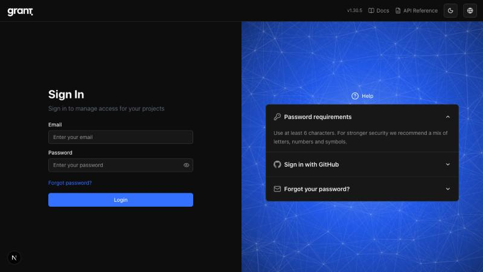
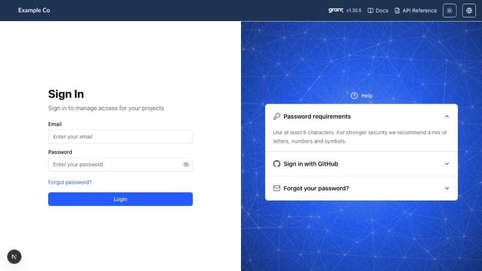
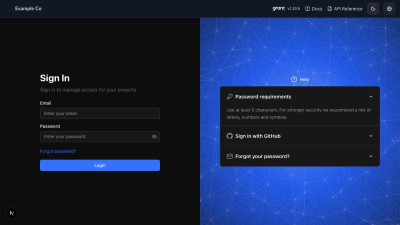

# Branding

A deployment can give the web app's header its own colours and logo. The settings are environment variables on the **API**. The API validates them at startup and sends them to the web app in `GET /api/config`, so one web image serves every deployment, branded or not.

Every setting is optional. With none set, the app looks exactly as it does out of the box, in both light and dark mode.

## Settings

| Variable                           | Value                      | Effect                                                                    |
| ---------------------------------- | -------------------------- | ------------------------------------------------------------------------- |
| `BRANDING_HEADER_BACKGROUND_LIGHT` | Colour                     | Header background in light mode.                                          |
| `BRANDING_HEADER_BACKGROUND_DARK`  | Colour                     | Header background in dark mode.                                           |
| `BRANDING_HEADER_FOREGROUND_LIGHT` | Colour                     | Header text and icons in light mode.                                      |
| `BRANDING_HEADER_FOREGROUND_DARK`  | Colour                     | Header text and icons in dark mode.                                       |
| `BRANDING_LOGO_URL_LIGHT`          | `https://` URL             | Logo in the header's logo slot; also used in dark mode when no dark logo. |
| `BRANDING_LOGO_URL_DARK`           | `https://` URL             | Logo in dark mode. Needs `BRANDING_LOGO_URL_LIGHT`.                       |
| `BRANDING_LOGO_ALT`                | Text, up to 120 characters | The logo's alt text. Unset, the web app uses its localised "Home" label.  |

- **Colours** are opaque CSS colours: `#rrggbb`, `#rgb`, `rgb(…)` or `hsl(…)`, with commas or spaces. Named colours, other colour spaces and colours with transparency are refused, because the header's contrast cannot be checked for them.
- **Logo URLs** must be absolute `https://` URLs without a user name or password. The browser loads the image from that address, so host it where your users can reach it. SVG or PNG with a transparent background works best; the header shows it 32px high and at most 192px wide.
- **A blank value counts as unset.**

## What changes in the header

- **With a logo set**, your logo takes the main logo position on the left and links home. Grant's logo moves to the right, shown small next to the version number. If your logo fails to load, the header shows Grant's logo in the main position instead of a broken image.
- **With a header background set** for a mode, the header is opaque in both modes, instead of translucent over the page. That keeps the colour you chose exactly the colour behind the text.
- **Inside the header**, the version, links, icons and the outline buttons for theme and language follow the header's colours. Menus that open from the header keep the app's normal colours.
- **Theme switching** works as before: light, dark and system. The colours and logo for each mode are set before the app's first paint, so there is no flash of the default header when the page loads or when the system theme changes.

The rest of the app, including the sign-in pages' own per-project branding, is unchanged.

The sign-in page with nothing set (top) and with the [example](#example) below (bottom), in light and dark mode:

| Light                                                       | Dark                                                      |
| ----------------------------------------------------------- | --------------------------------------------------------- |
|  |  |
|   |   |

## Contrast

The header's text must meet [WCAG 2.x AA](https://www.w3.org/TR/WCAG21/#contrast-minimum) (4.5:1) against its background, in each mode. The API checks each mode's pair at startup, and when a pair fails it logs a warning and corrects it:

- **A foreground that fails against its background is ignored.** The header uses the default text colour for that mode instead, if that passes.
- **When no foreground is set, or the default fails too,** the header uses black or white, whichever contrasts more. One of them always reaches at least 4.58:1 against an opaque colour.
- **A foreground set without a background** is checked against the default background for that mode and ignored if it fails.

An invalid value, such as a colour the API cannot parse or an `http://` logo URL, is also ignored with a warning. Nothing about branding stops the API from starting. The warnings appear once, after the configuration summary, and look like this:

```text
Branding: BRANDING_HEADER_FOREGROUND_DARK is ignored: #1e293b on #0f172a has contrast 1.22:1, below WCAG AA 4.5:1.
```

## Example

A dark blue header in light mode and a near-black one in dark mode, each with light text and its own logo:

```bash
BRANDING_HEADER_BACKGROUND_LIGHT=#1e3a5f
BRANDING_HEADER_FOREGROUND_LIGHT=#ffffff
BRANDING_HEADER_BACKGROUND_DARK=#0f172a
BRANDING_HEADER_FOREGROUND_DARK=#e2e8f0
BRANDING_LOGO_URL_LIGHT=https://cdn.example.com/brand/logo-light.svg
BRANDING_LOGO_URL_DARK=https://cdn.example.com/brand/logo-dark.svg
BRANDING_LOGO_ALT=Example Co
```

`GET /api/config` then returns:

```json
{
  "branding": {
    "logo": {
      "lightUrl": "https://cdn.example.com/brand/logo-light.svg",
      "darkUrl": "https://cdn.example.com/brand/logo-dark.svg",
      "alt": "Example Co"
    },
    "theme": {
      "light": { "header": "#1e3a5f", "header-foreground": "#ffffff" },
      "dark": { "header": "#0f172a", "header-foreground": "#e2e8f0" }
    }
  }
}
```

With nothing set, `branding` is `{ "logo": null, "theme": { "light": {}, "dark": {} } }`.

## How it fits the design system

The header reads its colours from two design tokens, `--header` and `--header-foreground`, defined in `apps/web/app/globals.css`. Their defaults are the page tokens `--background` and `--foreground`, which is why an unbranded header is unchanged. The web app applies the values from `branding.theme` as overrides of those tokens: light values under `:root:not(.dark)`, dark values under `.dark`. The `dark` class is set before first paint, so the overrides follow the theme with no script of their own.

`branding.theme` is keyed by token name so that later work can let a deployment override more of the theme the same way. See [ADR 0015](https://github.com/grant-js/grant/blob/main/decisions/0015-deployment-branding-as-token-overrides.md).
