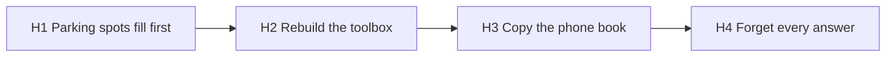
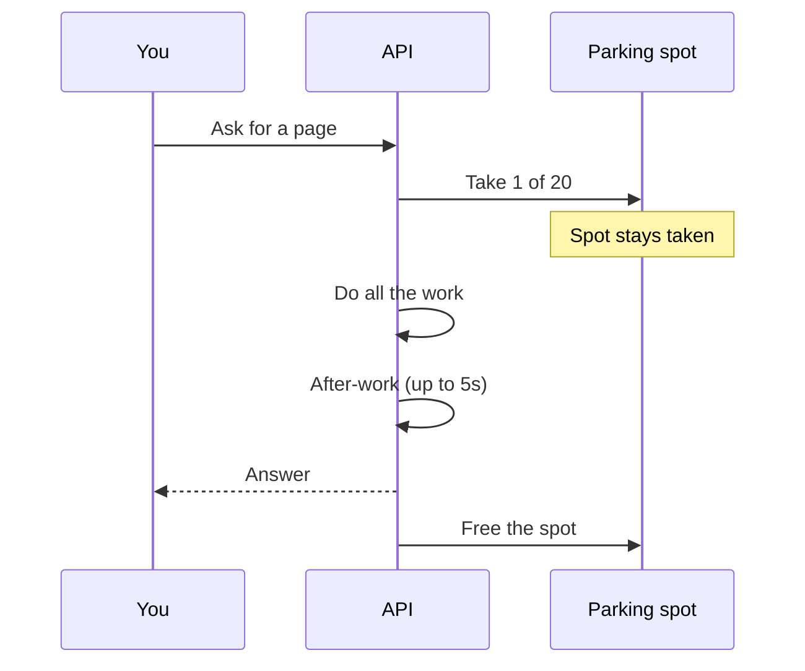
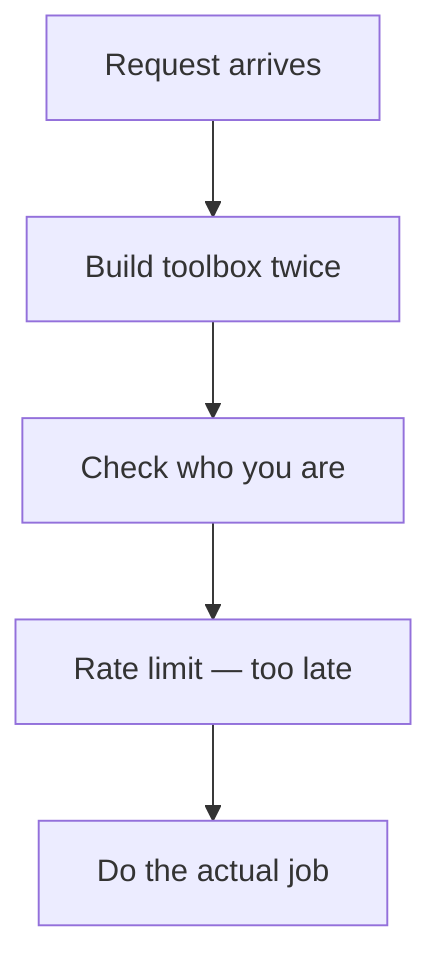
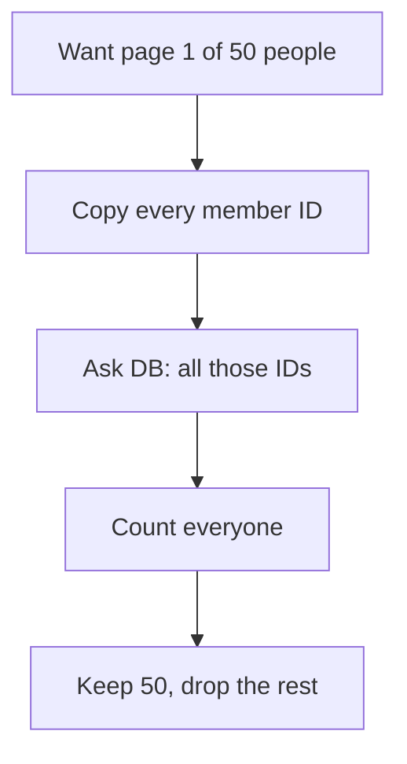
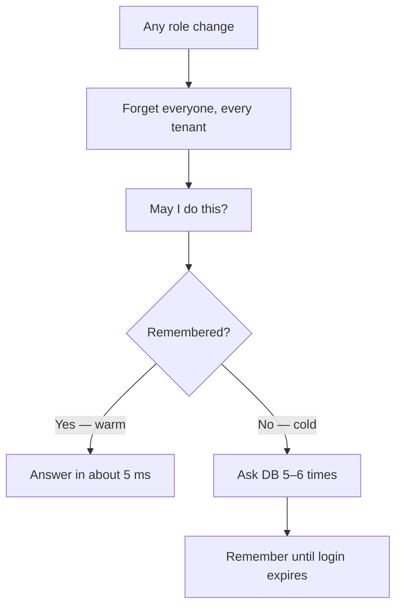

# IAM performance, in pictures

Simpler words for H1–H4. Same facts as [IAM performance diagnosis](./2026-10-24-iam-performance-diagnosis.md). Start at H1.

## The map

Read left to right: first the parking lot fills, then every request rebuilds its toolbox, then we copy the whole phone book to show one page, then one role change wipes everyone’s memory.

| #   | Everyday name | One line                                                                  |
| --- | ------------- | ------------------------------------------------------------------------- |
| H1  | Parking spots | Keep a database seat until the reply is done. Only 20 seats.              |
| H2  | Toolbox       | Assemble the whole kitchen before checking the guest list.                |
| H3  | Phone book    | Write every member ID, then show 50.                                      |
| H4  | Memory        | First “may I?” is slow. Repeat is fast. One role change forgets everyone. |

---

## H1 — Parking spots (look here first)

A database connection is a **parking spot**. A tenant-safe request takes one spot and keeps it until the answer is sent — including a little after-work (up to 5 seconds). There are only **20** spots.

When many people use the dashboard at once, new requests wait for a free spot. The SQL itself can look fine.

---

## H2 — Rebuild the toolbox

Every request builds ~66 data drawers, ~74 workbenches, and ~20 front desks — **twice** when tenant safety is on — **before** we check “are you asking too often?”

A “slow down” answer still paid that setup. This cost is on every click, not just big lists.

---

## H3 — Copy the phone book

To show 50 people we first write down **every** member ID, ask the database about that whole list, count everyone, then keep 50.

A recent fix stopped loading every full person row. It did **not** stop copying every ID. Page 1 and page 50 both start from the full list.

---

## H4 — Forget the answers

First “may I?” asks the database **5–6 times** (cold). A repeat of the same question is remembered (~5 ms, warm). Changing a role, group, or permission in **any** tenant throws away **everyone’s** remembered answers.

This is the only published p95: local 20 July 2026, ~272 users / ~371 permissions. Cold **10–23 ms**. Warm **5–8 ms**.

